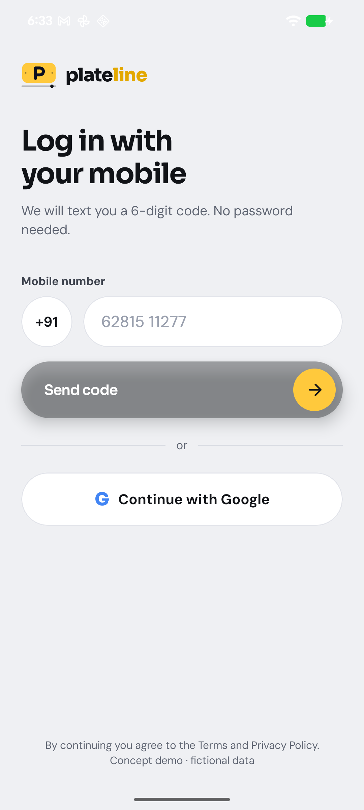
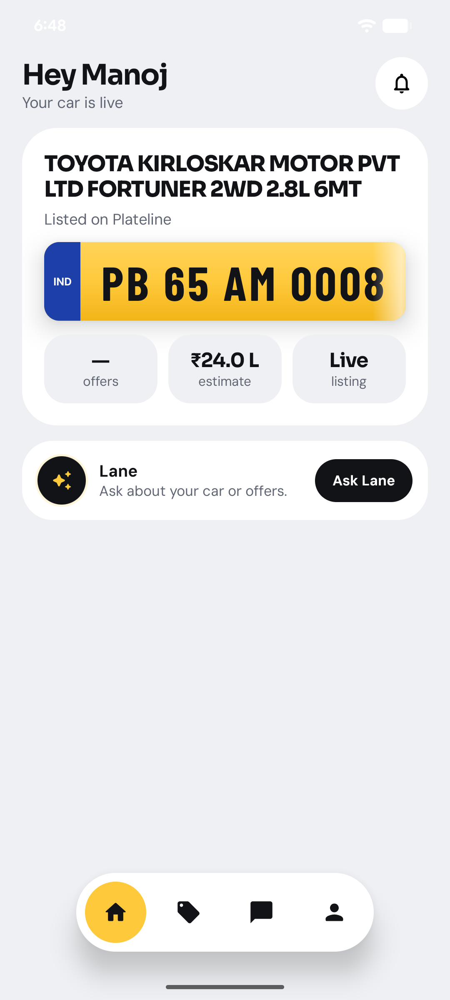
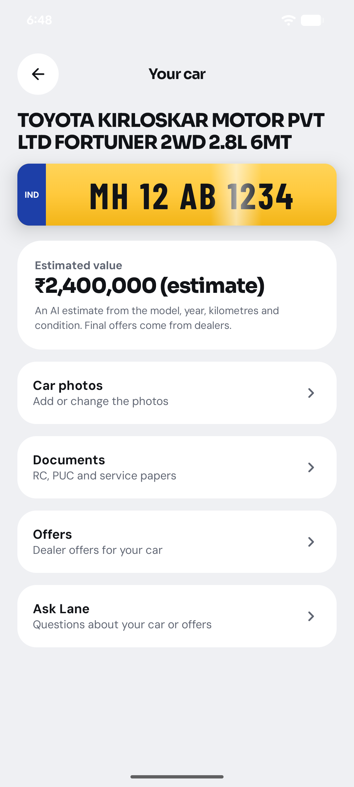
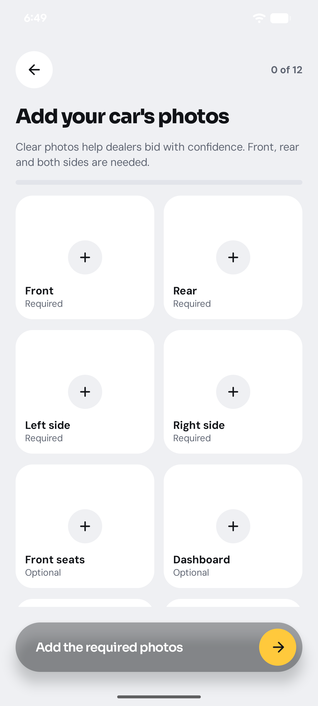
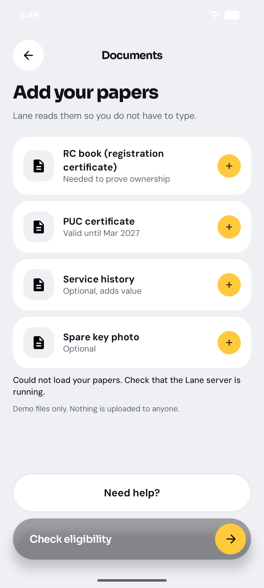
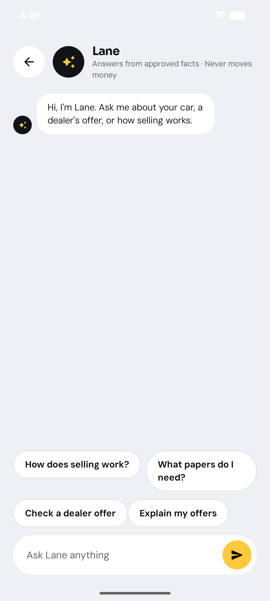

# Plateline (Android)

**Plateline** is a concept app for selling a used car in India. Enter the number plate, add the kilometres, get an AI value estimate, upload photos and papers, and ask **Lane**, a built-in AI assistant, about your car and dealer offers.

> Concept demo with fictional data. Dealer offers are samples, and the value estimate is an AI estimate, not live market prices.

## Screenshots

| Sign in | Home | Car details |
|:--:|:--:|:--:|
|  |  |  |

| Car photos | Papers | Lane chat |
|:--:|:--:|:--:|
|  |  |  |

## Features

- **Phone sign-in**: one-time code by SMS (Firebase Authentication, +91 numbers).
- **Vehicle lookup**: enter a plate and the app fetches the make, model and registration details through the Lane server.
- **Kilometres and condition**: required before any valuation runs, so no estimate is made without the reading.
- **AI value estimate**: a range that counts up on a dark showroom-style screen.
- **Car photos**: four required sides plus optional shots (front seats, dashboard, mileage, boot, wheels, back seats, engine, keys). Photos are saved on the server, and tapping one opens it full screen.
- **Papers**: RC (read by AI for plate and car details), PUC, service history and spare key photos. Each one is saved and can be opened or removed.
- **Eligibility, go live and offers**: checks, a live confirmation, sample dealer offers and an explanation of the net amount.
- **Lane chat**: ask questions about your car or offers. The chat knows your car's details, has quick-question chips that hide when the keyboard is open, and can explain your offers.
- **Server-driven screens**: the home and offers screens are JSON layouts rendered by `DynamicScreen`, so they can change without a new app release.

## How it works

```
Android app (Kotlin, Jetpack Compose)
   │  HTTPS / token header
   ▼
Lane server (FastAPI, runs on the developer's machine)  ── separate repo: plateline-agent
   │
   ├── OpenAI   (value estimate, reading the RC photo, chat)
   └── RapidAPI (vehicle lookup)

Firebase: Authentication (phone OTP), Firestore (listings and profile), Remote Config
```

API keys never reach the phone. The app only holds the server's secret token. Each RC photo is deleted from the server right after it is read.

## Tech stack

- Kotlin, Jetpack Compose (Material 3), Navigation Compose
- Firebase Authentication, Cloud Firestore, Remote Config
- OkHttp for calls to the Lane server
- Server-driven UI from JSON assets (`app/src/main/assets/screens/`)

## Project structure

```
app/src/main/java/com/inouiw/plateline/
├── config/        app configuration (feature switches)
├── data/          AgentApi (server calls), listing and profile repositories
├── dynamic/       DynamicScreen: renders JSON screen layouts
├── ui/
│   ├── PlatelineApp.kt      navigation and app state
│   ├── Components.kt        shared widgets (buttons, top bar, screen box)
│   ├── auth/                phone OTP sign-in
│   ├── screens/             Onboarding, Journey (valuation, estimate, photos),
│   │                        Support (papers, help, notifications), Agent (Lane chat, offers)
│   └── theme/               colours, type, motion
app/src/main/assets/screens/ server-driven JSON layouts
firestore.rules              owner-only access rules for Firestore
```

## Running it

1. Open the project in Android Studio with JDK 21.
2. Add your own `app/google-services.json` from a Firebase project. It isn't included in this repo.
3. Add these lines to `local.properties` (this file is not committed):
   ```properties
   agent.url=http://<your-computer-ip>:8001/
   agent.token=<the same value as PLATELINE_API_TOKEN in the server's .env>
   ```
   Over USB, you can use `agent.url=http://127.0.0.1:8001/` together with `adb reverse tcp:8001 tcp:8001`.
4. Start the Lane server from the `plateline-agent` repo.
5. Build and install:
   ```bash
   ./gradlew installDebug
   ```

## Status and roadmap

- [x] Phone sign-in, plate lookup, kilometres step, AI estimate
- [x] Photo and paper uploads with full-screen viewing
- [x] Lane chat with car context
- [ ] Google sign-in (placeholder)
- [ ] Real dealer offers (currently samples)
- [ ] Production security: key rotation, server hosting, rules review
- [ ] Automated UI tests

## Privacy

This is a prototype. Photos and papers are stored on the developer's server, not in the app, and the RC photo is sent to OpenAI only to be read. Do not use real customer data until the security and hosting work is finished.
